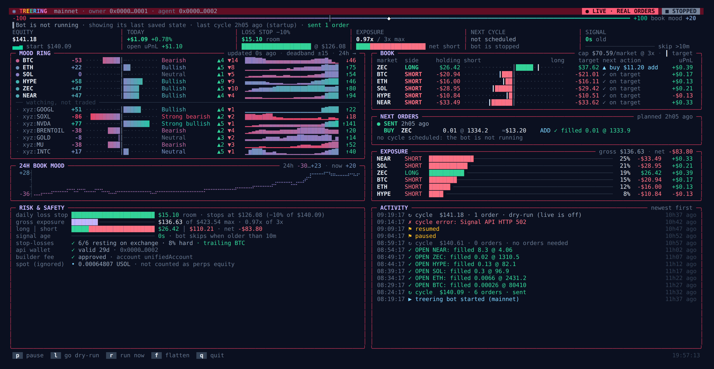
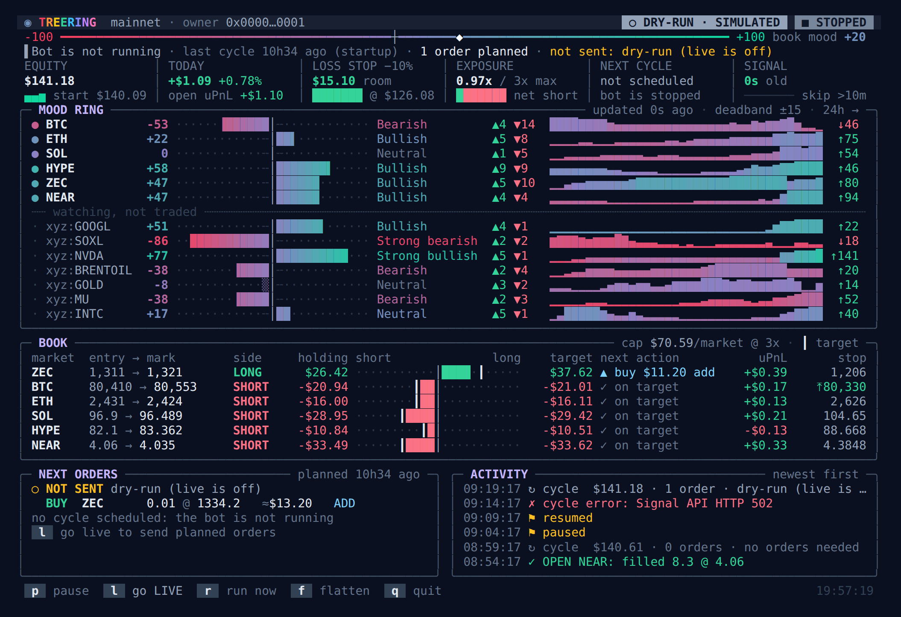
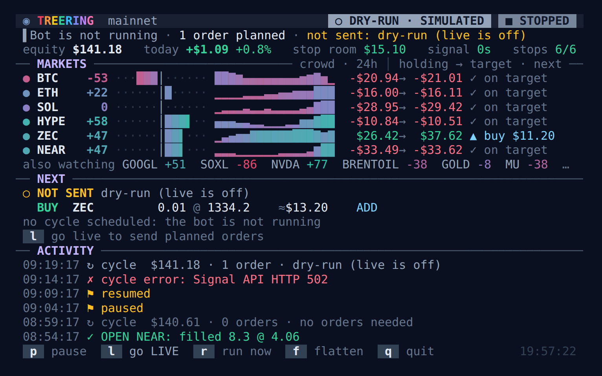

# Treering

A self-hosted trading bot for [Hyperliquid](https://hyperliquid.xyz) that follows the **Mood Ring**: a crowd-sentiment score (−100 to +100 per market) built from the live positioning of a curated set of consistently profitable Hyperliquid traders, published by [X1 Terminal](https://x1-terminal-20261029.vercel.app). Treering sizes positions from that score, trades your own account through a trading-only API wallet, protects every position with a stop-loss resting on the exchange, and comes with a terminal dashboard and Telegram alerts.



> **Risk warning.** This software places real orders with real money. It can lose money, including through bugs, exchange outages, slippage and the signal being wrong. Nothing here is financial advice. Run it in dry-run first, start small, and read the code.

## How it works

Every 5 minutes the bot:

1. Reads the public Mood Ring scores and your account state from Hyperliquid.
2. Sizes a target for each market: `equity × leverage ÷ markets × score/100`. Scores inside ±15 hold the current position. Reversing an open position needs |score| ≥ 25 (`flipMinScore`), so a weak opposite score holds instead of flipping. Gaps under $10 are skipped, and adds/trims under max($15, 20% of the position) are skipped as churn.
3. Sends the difference as IOC limit orders 1% through mid (closes before opens). Nothing is sent until you turn **live** on.
4. Keeps exactly one reduce-only stop-market order resting on Hyperliquid for every open position.

The sizing mirrors X1 Terminal's hosted Auto Trader, and the protections mirror the risk section of X1's copybot whitepaper.

| Protection | Behaviour |
|---|---|
| Hard stop | 8% adverse to entry, resting on the exchange (fires even if this bot is down), 10% slippage cap; resized when the position changes |
| Trailing stop | Arms at +4%, moves to breakeven +0.1%, then trails 4% behind the best price; only tightens |
| Re-entry block | After a stop fills, the coin is not re-opened until its signal flips, goes flat, leaves the signal, or its weight moves >25% |
| Daily loss stop | Once down 10% on the UTC day, the bot only reduces or closes |
| Drawdown stop | Pauses the bot when equity is 15% below its highest value seen (`maxDrawdownPct`, 0 = off). Positions keep their stops; resume when you have looked |
| Fail-safes | Skips trading when the signal is unreachable or its newest reading is over 10 minutes old (stops are still kept up to date), an expired API wallet, a missing fee approval or equity under $15 |

## Requirements

- Node.js 22+
- A Hyperliquid account with USDC in perps (or unified account mode)
- A **trading-only API wallet** (agent) authorized for that account. Agents can trade but cannot withdraw. Never give the bot your main wallet's key.
- By default every order includes X1's 0.05% builder fee (it's their signal). Approve it once from your account, or set `"builderFee": false`.

## Setup

```sh
git clone https://github.com/TreeCityWes/treering ~/treering && cd ~/treering
npm install
cp .env.agent.example .env.agent && chmod 600 .env.agent   # fill in, see below
npm test
npm run once        # one dry-run cycle: reads everything, sends nothing
```

`.env.agent` (git-ignored):

```sh
X1_ACCOUNT_ADDRESS=0xYourMainAccount      # the account that holds the funds
X1_AGENT_PRIVATE_KEY=0xApiWalletKey       # trading-only API wallet
X1_NETWORK=mainnet                        # or testnet
```

Optional `config.json` (defaults shown):

```json
{
  "leverage": 3, "killPct": 0.1, "minOrderUsd": 10, "intervalSec": 300, "slippage": 0.01,
  "markets": ["BTC", "ETH", "SOL", "HYPE", "ZEC", "NEAR"], "builderFee": true,
  "stops": { "enabled": true, "stopLossPct": 0.08, "trailArmPct": 0.04, "trailPct": 0.04,
             "stopSlippage": 0.1, "reentryWeightChange": 0.25, "whenNotLive": true }
}
```

The `xyz:*` stock and commodity markets (GOOGL, NVDA, GOLD, …) are supported but off by default: in Hyperliquid's default account mode they need USDC on the xyz dex, which an API wallet cannot move.

## Run it as a service

```sh
cp deploy/treering.service ~/.config/systemd/user/
systemctl --user daemon-reload && systemctl --user enable --now treering
loginctl enable-linger $USER          # keep running after logout
journalctl --user -u treering -f      # logs
```

The unit files assume the repo lives in `~/treering`; edit the paths if not.

On a shared server, or one where other software runs under your login, use the hardened layout in [`deploy/system`](deploy/system/README.md): the bot runs as its own unprivileged user and its key and code are root-only.

## Dashboard

```sh
npm run tui          # interactive
npm run watch        # read-only, refreshes every 2s under watch(1)
```

| Key | Action |
|---|---|
| `p` | Pause / resume (stops stay in place) |
| `l` | Live on/off (turning live on asks for `y`) |
| `r` | Run a cycle now |
| `f` | Flatten: market-close everything and pause (asks for `y`) |
| `q` | Quit the dashboard (the bot keeps running) |

The layout adapts from 80×24 to 220×60. Without a terminal UI: `node src/ctl.js status | live on|off | pause | resume | run | flatten`.

<p align="center">
  
  
</p>

Screenshots use the demo data in `fixtures/demo` (`TREERING_DATA_DIR=fixtures/demo npm run tui`).

## Telegram alerts

Put `TELEGRAM_BOT_TOKEN` and `TELEGRAM_CHAT_ID` in `.env.alerts` (git-ignored). You'll be messaged on start/stop, orders sent or rejected, stop-loss fills, live/pause changes, cycle errors (first, persistent, recovered), the daily loss stop, the drawdown stop, a stale or unreachable signal, positions without a resting stop, API wallet expiry, and a daily summary.

A separate watchdog alerts if the bot stops cycling:

```sh
cp deploy/treering-watchdog.{service,timer} ~/.config/systemd/user/
systemctl --user daemon-reload && systemctl --user enable --now treering-watchdog.timer
```

## Project layout

| Path | What |
|---|---|
| `src/bot.js` | The cycle: signal → targets → orders → stop sync → alerts |
| `src/strategy.js` | Target sizing and order building (pure, tested) |
| `src/stops.js` | Hard stop, trailing stop, re-entry block, exchange sync |
| `src/hl.js` | Hyperliquid reads, signal fetch, order sending |
| `src/tui.js`, `src/tui/` | Dashboard |
| `src/alerts.js`, `src/watchdog.js` | Telegram alerts and the watchdog |
| `test/` | `node --test` suites |

## Credits

- The Mood Ring signal and the Auto Trader sizing model come from [X1 Terminal](https://github.com/jacklevin74/x1-terminal) by Jack Levin; `src/strategy.js` ports its `targets.ts`. The stop-loss behaviour follows X1's published copybot whitepaper.
- Built on [`@nktkas/hyperliquid`](https://github.com/nktkas/hyperliquid) and [viem](https://viem.sh).

Treering is an independent project and is not affiliated with Hyperliquid or X1.

## License

MIT
